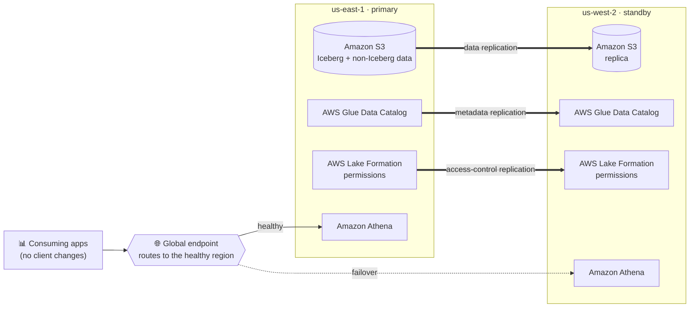

<div align="center">

# Hey, I'm Rahul 👋

<a href="https://github.com/rahull97">
  
</a>

**Data Engineer · Software Engineer II at JPMorgan Chase · Mumbai, India**

[](https://www.linkedin.com/in/rahull97/)
[](mailto:techrahullalwani@gmail.com)


</div>

---

### ⚡ TL;DR

I design **cloud data platforms that don't go down**. At JPMorgan Chase I build the **Consumer & Community Banking (CCB) Data Lake** on AWS and led its **multi-region resiliency and disaster recovery** architecture. Before that, I built Spark and Kafka pipelines handling **tens of millions of events a day** for media analytics and healthcare imaging.

<div align="center">

| 🗄️ **500+ TB** | ⏱️ **< 1 hr RTO** | 🪣 **380+ S3 buckets** | 📈 **50M+ events/day** | 🚀 **1M+ events/sec** |
|:---:|:---:|:---:|:---:|:---:|
| data lake made multi-region | recovery time after a region failure | DR provisioning, fully automated | PySpark ingestion pipelines | Kafka + Druid ingestion, tuned |

</div>

---

### 🏗️ The thing I'm proudest of: a data lake that survives a region outage

When a whole AWS region fails, consumers of the CCB Data Lake shouldn't notice. Here's the shape of what I designed:



- **Global endpoint** sends traffic to whichever region is healthy, so failover needs no change on the client side.
- **Cross-region Glue Catalog replication** keeps Apache Iceberg and non-Iceberg tables consistent in both regions.
- **Lake Formation permission replication** means access controls still hold after failover.
- **Automated lifecycle for 380+ S3 buckets** replaced manual provisioning for DR readiness.
- Result: **RTO under 1 hour** for a **500+ TB** lake.

---

### 💼 Where I've worked

<table>
<tr>
<td width="140"><b>2024 – now</b></td>
<td>
<b>Software Engineer II · JPMorgan Chase & Co.</b><br/>
Building the CCB Data Lake with Python, SQL, S3, Glue, Lake Formation, Iceberg and Athena. Led its multi-region resiliency and disaster recovery design (the diagram above).
</td>
</tr>
<tr>
<td><b>2022 – 2024</b></td>
<td>
<b>Senior Data Engineer · MarketCast</b><br/>
• PySpark ETL ingesting <b>50M+ pixel-tracker events/day</b> to analyse behaviour across web and connected devices.<br/>
• Survey processing pipelines behind cross-tabs and Tableau dashboards: report turnaround cut from <b>2 days to 4 hours</b>.<br/>
• Joined retail purchase data with TV ad viewership to measure how ads move brand sales.
</td>
</tr>
<tr>
<td><b>2019 – 2022</b></td>
<td>
<b>Big Data & Cloud Developer · Abzooba</b><br/>
• Built a <b>PySpark library for reading and analysing DICOM medical images</b> at scale, published as a third-party Spark package.<br/>
• Tuned Kafka and Druid to sustain <b>1M+ events per second</b> under heavy ingestion.<br/>
• Near real-time infra monitoring (CPU, memory, network, disk) with Prometheus and Grafana.
</td>
</tr>
</table>

---

### 🧰 What I work with

| Area | Tools |
|---|---|
| **Languages** |   |
| **Lakehouse & processing** |      |
| **AWS** |           |
| **Architecture & IaC** |   |
| **Observability & BI** |    |

**Concepts:** data lakes & lakehouses · ETL/ELT · data modelling · data warehousing · high availability · disaster recovery

---

<details>
<summary><b>🐍 Me, as a Python class (click to expand)</b></summary>

```python
class Rahul:
    role       = "Software Engineer II, Data Engineering @ JPMorgan Chase"
    based_in   = "Mumbai, India"
    experience = "7+ years"

    stack = {
        "lakehouse": ["Apache Iceberg", "AWS Glue", "Lake Formation", "Athena", "S3"],
        "compute":   ["PySpark", "Kafka", "Druid", "Snowflake"],
        "infra":     ["Terraform", "multi-region HA/DR", "Prometheus", "Grafana"],
    }

    def principles(self):
        return [
            "Design for the region that fails, not the one that works.",
            "Automate anything you'd have to do twice (380 buckets taught me that).",
            "A pipeline isn't done until it's observable.",
        ]

    def currently(self):
        return "Making a 500+ TB data lake boring to fail over."
```

</details>

<details>
<summary><b>🎓 Education & certifications</b></summary>

- **B.E. Computer Engineering**, Sinhgad College of Engineering, Savitribai Phule Pune University (2015 – 2019) · CGPA 8.61 / 10
- **SnowPro Core Certification**, Snowflake

</details>

---

<div align="center">

### 🤝 Let's talk

I'm happy to chat about **lakehouse architecture, Apache Iceberg, AWS disaster recovery, or scaling Spark and Kafka pipelines**.

[](https://www.linkedin.com/in/rahull97/)
[](mailto:techrahullalwani@gmail.com)

<sub>⭐ If something here was useful, a follow is appreciated.</sub>

</div>
