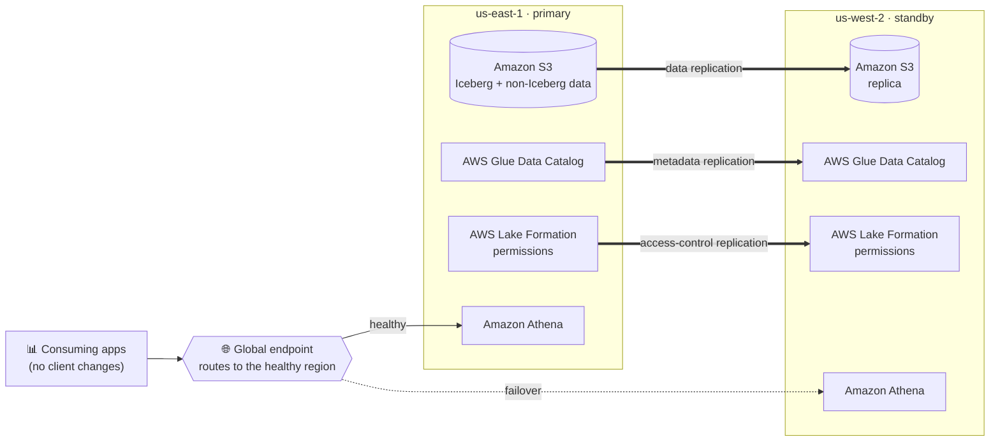

<div align="center">

# Hey, I'm Rahul 👋

### Data Engineer · Building resilient data platforms on AWS

**Software Engineer II at JPMorgan Chase · Mumbai, India**

> *Show up every day. Build it to last. Never stop learning.*

[](https://www.linkedin.com/in/rahull97/)
[](mailto:techrahullalwani@gmail.com)


</div>

---

### 🧭 About me

I'm a data engineer who likes hard, unglamorous problems: the ones you only solve with patience and steady effort. Over 7+ years I've gone from tuning Kafka clusters to designing **disaster recovery for a 500+ TB banking data lake**, learning each layer of the stack by building on it.

What drives me is simple: **data platforms that people can trust**, even on their worst day.

---

### 🧗 The climb so far

Every role was a step up built on the one before it. No shortcuts, just compounding.

```text
                                                        ┌──────────────────────────────┐
                                                        │ 2024 → now · JPMorgan Chase  │
                                                        │ Software Engineer II         │
                                                        │ Multi-region DR for a 500+ TB│
                                                        │ data lake · RTO < 1 hour     │
                                   ┌────────────────────┴───────────┬──────────────────┘
                                   │ 2022 → 2024 · MarketCast       │
                                   │ Senior Data Engineer           │
                                   │ 50M+ events/day · reports from │
                                   │ 2 days → 4 hours               │
              ┌────────────────────┴───────────────┬────────────────┘
              │ 2019 → 2022 · Abzooba              │
              │ Big Data & Cloud Developer         │
              │ Kafka + Druid at 1M+ events/sec    │
              │ Open-source PySpark DICOM package  │
──────────────┴────────────────────────────────────┘
 2015 → 2019 · B.E. Computer Engineering (CGPA 8.61 / 10)
```

---

### ⚡ Proof of work

<div align="center">

| 🗄️ **500+ TB** | ⏱️ **< 1 hr RTO** | 🪣 **380+ S3 buckets** | 📈 **50M+ events/day** | 🚀 **1M+ events/sec** |
|:---:|:---:|:---:|:---:|:---:|
| data lake made multi-region | recovery after a region failure | DR provisioning, fully automated | PySpark ingestion pipelines | Kafka + Druid ingestion, tuned |

</div>

---

### 🏗️ Perseverance, in architecture form

When a whole AWS region fails, the people using the CCB Data Lake shouldn't notice. Designing for the day everything goes wrong is what I'm proudest of:



- **Global endpoint** sends traffic to whichever region is healthy, so failover needs no change on the client side.
- **Cross-region Glue Catalog replication** keeps Apache Iceberg and non-Iceberg tables consistent in both regions.
- **Lake Formation permission replication** means access controls still hold after failover.
- **Automated lifecycle for 380+ S3 buckets** replaced manual provisioning for DR readiness.

---

### 📐 Discipline: how I work

| Principle | What it looked like in practice |
|---|---|
| **Design for the bad day** | Multi-region resiliency so a region outage costs under an hour, not days. |
| **Automate the second time** | 380+ S3 buckets went from manual setup to fully automated lifecycle management. |
| **Measure the impact** | Survey pipelines that cut report turnaround from 2 days to 4 hours. |
| **If it isn't observable, it isn't done** | Near real-time CPU, memory, network and disk monitoring with Prometheus and Grafana. |
| **Push the limits, then hold them** | Tuned Kafka and Druid to sustain 1M+ events per second under heavy load. |

---

### 🔥 Passion: learning in public

- 📦 **Gave back to open source:** built a PySpark library for reading and analysing DICOM medical images at scale, published as a third-party Spark package.
- 🎓 **Learned beyond the day job:** earned the **SnowPro Core Certification** from Snowflake.
- 🔁 **Kept widening the stack:** from streaming (Kafka, Druid) to batch (PySpark) to lakehouse (Iceberg, Glue, Lake Formation) to cloud architecture (multi-region HA/DR, Terraform).
- 🌱 **Currently going deeper on:** Apache Iceberg at scale, lakehouse architecture, and resilient cloud data platforms.

---

### 🧰 Toolbox

| Area | Tools |
|---|---|
| **Languages** |   |
| **Lakehouse & processing** |      |
| **AWS** |           |
| **Architecture & IaC** |   |
| **Observability & BI** |    |

**Concepts:** data lakes & lakehouses · ETL/ELT · data modelling · data warehousing · high availability · disaster recovery

---

<details>
<summary><b>💼 Full experience (click to expand)</b></summary>

**Software Engineer II · JPMorgan Chase & Co.** · Apr 2024 – present
- Designed multi-region resiliency for the CCB Data Lake (500+ TB) across us-east-1 and us-west-2, bringing RTO under 1 hour.
- Architected a global endpoint that routes traffic to the healthy region, with no client-side changes on failover.
- Built cross-region metadata replication for AWS Glue Data Catalog tables (Iceberg and non-Iceberg).
- Replicated AWS Lake Formation permissions across regions so access controls hold after failover.
- Automated creation and lifecycle management of 380+ S3 buckets for DR readiness.

**Senior Data Engineer · MarketCast** · Apr 2022 – Apr 2024
- PySpark ETL ingesting 50M+ pixel-tracker events/day across web and connected devices.
- Survey processing pipelines behind cross-tabs and Tableau dashboards; turnaround cut from 2 days to 4 hours.
- Joined retail purchase data with TV ad viewership to measure advertising impact on brand sales.

**Big Data & Cloud Developer · Abzooba** · Jul 2019 – Apr 2022
- PySpark library for DICOM medical images at scale, published as a third-party Spark package.
- Tuned Kafka and Druid to sustain 1M+ events per second.
- Near real-time infrastructure monitoring with Prometheus and Grafana.

**Education:** B.E. Computer Engineering, Sinhgad College of Engineering, SPPU (2015 – 2019) · CGPA 8.61 / 10
**Certification:** SnowPro Core, Snowflake

</details>

---

<div align="center">

### 🤝 Let's build something that lasts

Happy to talk **lakehouse architecture, Apache Iceberg, AWS disaster recovery, or scaling Spark and Kafka pipelines**.

[](https://www.linkedin.com/in/rahull97/)
[](mailto:techrahullalwani@gmail.com)

<sub>*Small steps, every day. That's the whole secret.*</sub>

</div>
